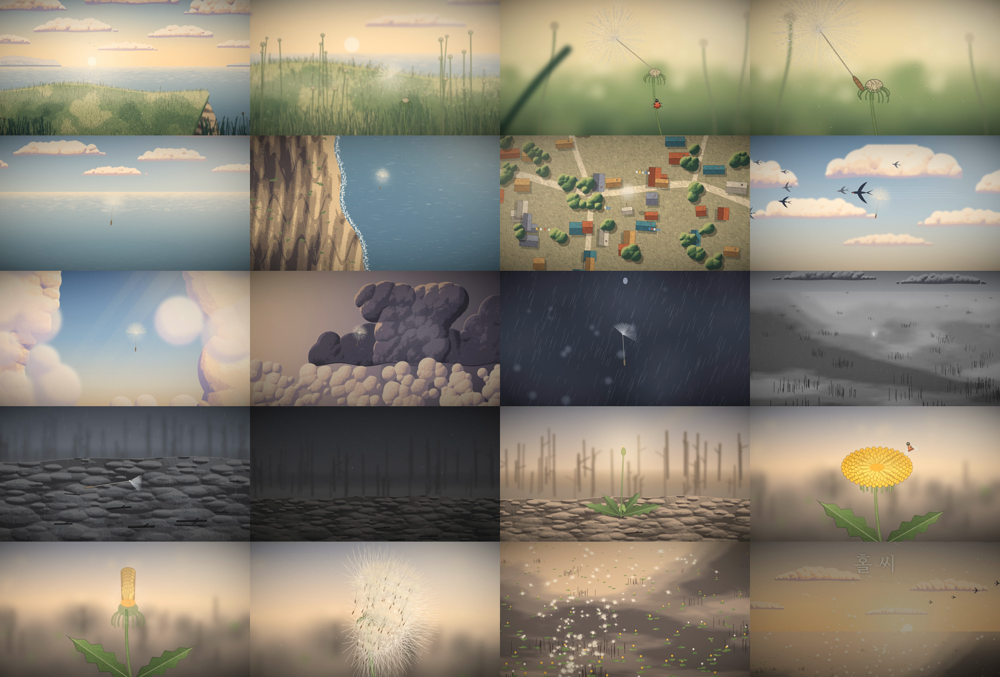

# 홀씨 (HOLSSI): 90초 코드 애니메이션

GoXoN × Claude. 외부 이미지·영상·음원 없이 **전부 Python 코드**로 그리고 합성한 90초 단편 애니메이션.
〈The Moss Keeper〉(ChetasLua/moss-keeper)를 분석해, 회화풍 질감·피사계 심도·조용한 도입·작은 존재와 거대한 풍경의 대비를 받아들였다.



- 사양: 1920×1080 (1.85:1 레터박스), 24fps, 90초, 18컷, H.264 + AAC 스테레오
- 음악: [`holssi_music.mp3`](holssi_music.mp3) (320kbps, 90초)
- 완성 영상(약 59MB)은 용량 때문에 올리지 않았다. 아래 방법으로 다시 만든다.

## 로그라인

씨앗이 모두 떠나 버린 들판에 마지막으로 남은 홀씨 한 톨이, 바람을 타고 바다와 구름을 건너다
폭풍에 꺾여 잿빛 땅에 떨어진다. 그리고 그곳에서 꽃을 피워 수백 개의 홀씨를 다시 하늘로 띄운다.

**주제:** 작은 것은 사라지지 않는다. 멀리 가서 다시 시작될 뿐이다.

## 구조

| 막 | 시간 | 사건 | 색 |
|---|---|---|---|
| 1. 아침 들판 | 0:00–0:20 | 혼자 남은 홀씨가 떠난다 | 금빛·연둣빛 |
| 2. 여정 | 0:20–0:52 | 절벽, 바다, 마을, 제비, 구름 위의 절정 | 푸른 바다·흰 구름 |
| 3. 추락과 기다림 | 0:52–1:16 | 폭풍에 꺾여 잿빛 땅으로. 긴 기다림 끝에 싹 | 보라 → 무채색 잿빛 → 초록 한 점 |
| 4. 순환 | 1:16–1:30 | 꽃이 피고, 수백 개의 홀씨가 떠난다 | 노랑·금빛 하늘 |

복선과 회수: 갓털 하나뿐이던 홀씨(C2)가 마지막에 수백 개로 날아오른다(C17). 줄기를 흔들고 떠난 무당벌레(C3)처럼
새 무당벌레가 꽃잎에 앉는다(C15). 위협이던 제비 떼(C8)가 결말에서는 홀씨 무리 사이를 그냥 지나간다(C18).

## 컷 리스트

| C# | 시간 | 샷 | 화면 |
|---|---|---|---|
| 1 | 0:00–0:07 | ELS | 해 뜨는 바닷가 절벽 위 들판. 씨앗이 다 날아간 민들레 줄기들 |
| 2 | 0:07–0:12 | MS, 푸시인 | 맨 줄기들 사이, 갓털 하나가 남은 줄기 |
| 3 | 0:12–0:17 | ECU 접사 | 이슬 맺힌 홀씨. 무당벌레가 줄기를 기어오르고 줄기가 휜다 |
| 4 | 0:17–0:20 | CU | 무당벌레가 날아가고, 돌풍에 홀씨가 떨어져 나간다 |
| 5 | 0:20–0:26 | 트래킹 | 홀씨가 풀꽃 위로 떠올라 바다가 보이는 하늘로 |
| 6 | 0:26–0:31 | 부감 | 절벽 끝을 넘어 까마득한 바다 위로 |
| 7 | 0:31–0:36 | 부감 | 어촌 지붕 위를 가로지르는 홀씨와 작은 그림자 |
| 8 | 0:36–0:40 | MS | 제비 떼, 한 마리가 덮치고 홀씨가 날갯바람에 뒹군다 |
| 9 | 0:40–0:48 | 롱 트래킹 | 햇빛 든 구름 협곡 사이로 상승. 가장 고요한 순간 |
| 10 | 0:48–0:52 | ELS | 검은 폭풍 탑, 홀씨가 빨려 들어간다 |
| 11 | 0:52–0:56 | CU | 폭풍 속. 빗방울에 맞아 갓털이 젖어 뭉치고 떨어진다 |
| 12 | 0:56–1:00 | ELS | 끝없는 잿빛 평원 위로 떨어지는 작은 점 |
| 13 | 1:00–1:04 | 접사 | 젖은 잿더미 위에 쓰러진 홀씨, 빗방울 |
| 14 | 1:04–1:16 | 롱테이크 타임랩스 | 밤낮, 눈이 덮였다 녹고, 싹이 트고 꽃봉오리. 새벽빛 |
| 15 | 1:16–1:20 | CU | 노란 민들레가 핀다. 무당벌레가 내려앉는다 |
| 16 | 1:20–1:23 | CU | 꽃이 오므렸다 하얀 솜털 공으로 열린다 |
| 17 | 1:23–1:26 | ECU | 바람이 돌아오고 홀씨들이 한꺼번에 떠난다 |
| 18 | 1:26–1:30 | 크레인 업 | 초록과 노랑이 돋은 평원 위, 해를 향해 흐르는 홀씨 무리. 타이틀 |

## 기술

- `eng.py`: 회화풍 렌더 엔진. 원형 돔을 겹친 높이장(height field)에 빛 방향 기복을 계산해 4단 톤으로 칠하고
  (그림자·중간·밝은 면·하이라이트), 톤 경계에 붓 질감과 fbm 얼룩을 섞는다. 레이어별 피사계 심도·공기원근,
  바람 흔들림(remap), 필름 그레인, 홀씨·무당벌레·제비·민들레 그리기
- `shots.py` / `shots_a`~`shots_d.py`: 18컷 장면 함수 (정적 레이어는 컷마다 한 번 그려 캐시)
- `render.py`: 컷 테이블, 2코어 병렬 청크 인코딩
- `audio.py`: 자연음·폭풍·효과음과 음악(첼레스타 모티프, 패드, 하프, 피아노). 컷 타이밍에 맞춰 합성, 느린 레벨러로 마스터링
- `samp.py`: 특정 컷·시각의 확인용 프레임을 뽑는 도구

## 다시 만들기

```bash
pip install numpy opencv-python pillow scipy pycairo   # + ffmpeg
python3 audio.py                         # holssi.wav
python3 samp.py c09:44 c14:75.4          # 확인용 프레임 (test/)
python3 render.py full                   # chunks/*.mp4 (2코어 약 12분)
cd chunks && ffmpeg -f concat -safe 0 -i list.txt -i ../holssi.wav \
  -c:v libx264 -crf 21 -c:a aac -b:a 256k -movflags +faststart ../HOLSSI.mp4
```

## 알려진 한계

- 무당벌레와 잎이 단순한 벡터 그림이라 레퍼런스의 손그림 밀도에는 못 미친다.
- 홀씨의 비행 궤적이 수작업 경로라 일부 구간에서 기계적으로 느껴질 수 있다.
