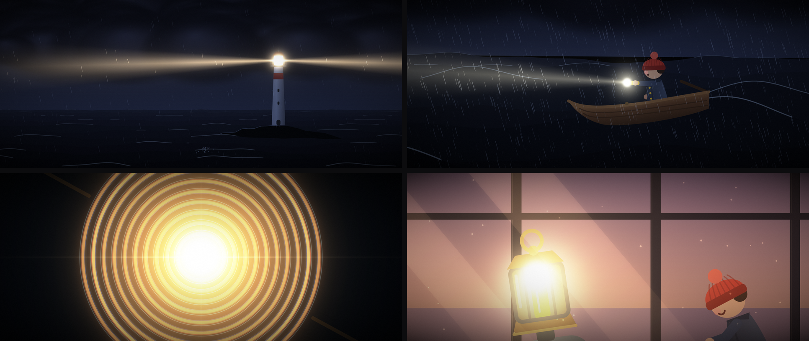

# 빛지기 (THE KEEPER): 1분 코드 애니메이션

GoXoN × Claude. 외부 이미지·영상·음원 없이 **전부 Python 코드**로 그리고 합성한 60초 단편 애니메이션.
모든 프레임은 시간 t의 순수 함수라서 어떤 컷이든 독립적으로 다시 렌더할 수 있다.



- 사양: 1920×1080 (2.39:1 시네마스코프 레터박스), 30fps, 60초, 18컷, H.264 + AAC 스테레오
- 음악: [`keeper_music.mp3`](keeper_music.mp3) (320kbps, 60초)
- 완성 영상(약 52MB)은 용량 때문에 이 저장소에 올리지 않았다. 아래 방법으로 다시 만든다.

## 로그라인

폭풍 치는 밤, 등대 전구가 터진다. 작은 등대 로봇은 암초로 떠밀려 가는 아이의 쪽배를 구하려고
자기 머리 속 불씨를 꺼내 렌즈에 끼운다.

**주제:** 빛은 건네질 때 꺼지지 않는다.

## 등장인물 (대사 없음)

- **빛지기:** 양철 몸통에 유리 랜턴을 머리로 얹은 작은 로봇. 얼굴이 없고, 랜턴 속 불씨의 밝기와 떨림이 표정이다.
- **아이:** 8살쯤, 붉은 털모자. 장난감 손전등 하나로 구조 신호를 보낸다.

## 구조

| 단계 | 시점 | 사건 |
|---|---|---|
| 도입 사건 | 0:05 | 등대 전구가 터져 꺼진다 |
| 1막 전환 | 0:20 | 망원경 너머로 쪽배 앞의 암초가 보인다 |
| 미드포인트 | 0:29 | 자기 불씨를 꺼내 렌즈에 끼운다 |
| 클라이맥스 | 0:35–0:42 | 빛기둥이 쪽배를 구한다 |
| 최저점 | 0:42 | 빈 머리로 꺼져 주저앉은 빛지기 |
| 결말 | 0:52–1:00 | 아이의 손전등이 빛지기의 새 불씨가 된다 |

복선과 회수: C5에서 아무도 응답하지 않던 아이의 손전등이 C16에서 빛지기의 새 불씨가 된다.
C1의 꺼진 등대와 C18의 새벽 등대는 같은 구도로 짝을 이룬다.

## 컷 리스트

| C# | 시간 | 샷 | 화면 | 전환 |
|---|---|---|---|---|
| 1 | 0:00–0:05 | ELS | 밤바다의 등대. 광선이 지직거리며 꺼지고, 램프실에 작은 불빛 하나가 남는다 | 컷 |
| 2 | 0:05–0:09 | MS | 램프실. 빛지기가 전구를 두드리자 전구가 터진다 | 컷 |
| 3 | 0:09–0:12 | CU | 랜턴 속 불씨가 움찔한다. 창밖 번개 | 번개 플래시 컷 |
| 4 | 0:12–0:16 | ELS, 줌인 | 먹구름 벽 아래 깜빡이는 점 하나 | 컷 |
| 5 | 0:16–0:20 | MS | 쪽배의 아이가 등대 쪽으로 손전등을 깜빡인다 | 컷 |
| 6 | 0:20–0:23 | POV (망원경) | 쪽배에서 옆으로 돌리면 이빨 같은 암초 | 컷 |
| 7 | 0:23–0:26 | CU | 망원경을 내리고, 두 손으로 자기 랜턴을 감싼다 | 컷 |
| 8 | 0:26–0:29 | 로우앵글 | 비바람 속 사다리를 오른다 | 컷 |
| 9 | 0:29–0:32 | ECU 인서트 | 불씨를 꺼내 렌즈 중심에 끼운다 | 컷 |
| 10 | 0:32–0:35 | CU | 프레넬 렌즈 고리마다 빛이 번져 터진다 | 화이트아웃 |
| 11 | 0:35–0:39 | ELS | 빛기둥이 폭풍을 가르고 쪽배를 비춘다 | 컷 |
| 12 | 0:39–0:42 | MS | 빛 속에 드러난 암초, 아이가 키를 꺾는다 | 컷 |
| 13 | 0:42–0:45 | MS | 렌즈 아래 꺼진 채 주저앉은 빛지기 | 디졸브 |
| 14 | 0:45–0:49 | ELS | 새벽. 폭풍이 걷히고 쪽배가 섬에 닿아 있다 | 컷 |
| 15 | 0:49–0:52 | MS | 아이가 사다리를 올라와 빛지기를 찾는다 | 컷 |
| 16 | 0:52–0:55 | ECU 인서트 | 장난감 손전등을 빈 랜턴에 넣고 딸깍 | 컷 |
| 17 | 0:55–0:57 | CU | 빛이 깜빡이다 켜지고, 빛지기가 고개를 든다 | 컷 |
| 18 | 0:57–1:00 | 풀아웃 | 갤러리의 두 인물에서 새벽 등대 전체로. 타이틀 | 페이드아웃 |

## 파일

- `engine.py`: 렌더 엔진. cairo 벡터 장면 레이어와 가산 발광 레이어, 블룸, 그레이딩. 캐릭터 2D 리그(빛지기·아이),
  절차적 바다, 부드러운 구름, 비(광선 속에서만 반짝임), 프랙탈 번개, 메시 그라디언트 광선, 등대, 프레넬 렌즈
- `shots.py`: 18컷 장면 함수와 전체 타임라인(번개 시점, 폭풍 세기)
- `render.py`: 드라이버. 디졸브, 타이틀, 페이드, 2코어 병렬 청크 인코딩
- `audio.py`: 사운드 디자인과 음악. 컷마다 실내외 소리 원근 전환, 천둥, 효과음, D단조 모티프에서 D장조 엔딩

## 다시 만들기

```bash
pip install numpy opencv-python pillow scipy pycairo   # + ffmpeg 필요
python3 audio.py                         # keeper.wav (약 7초)
python3 render.py test 1.5 17.5 34 56.6  # 확인용 프레임 (test/*.png)
python3 render.py full                   # chunks/*.mp4 (2코어 약 5분)
cd chunks && ffmpeg -f concat -safe 0 -i list.txt -i ../keeper.wav \
  -c:v copy -c:a aac -b:a 256k -movflags +faststart -shortest ../KEEPER.mp4
```

자막 폰트: Noto Serif CJK KR (SemiBold, Light)

## 알려진 사항

- C9에서 불씨를 받쳐 든 로봇 손이 손보다는 집게처럼 보인다.
