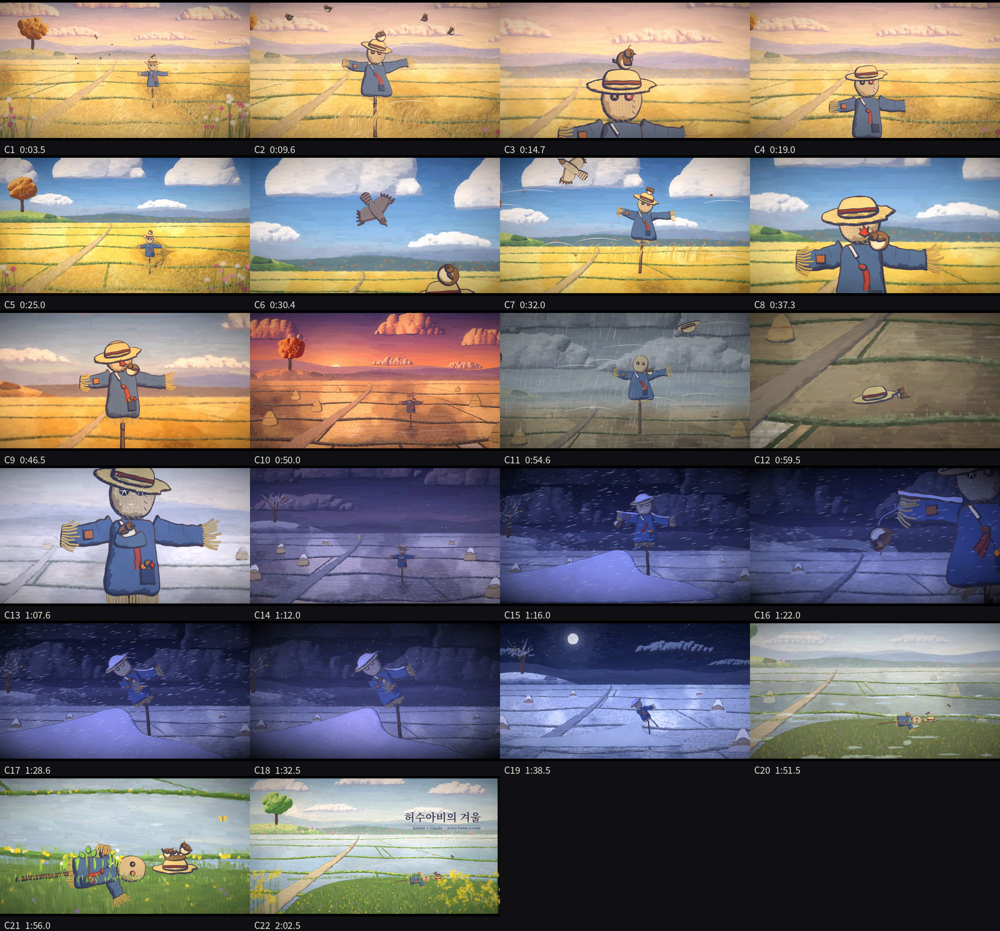

# 허수아비의 겨울 (The Scarecrow's Winter): 125초 손그림 셀풍 코드 애니메이션

GoXoN × Claude. 외부 이미지·영상·음원 없이 **전부 Python 코드**(cairo + numpy + OpenCV)로 그리고 합성한 단편.
80~90년대 극장판 셀 애니메이션처럼 보이게 하는 것이 목표였다. 평면 셀과 그림자 1~2톤, 펜 압력 외곽선, 포스터컬러 배경,
투스(12fps) 타이밍을 썼다.



- 사양: 1920×1080 (1.85:1 레터박스), 24fps, 125초, 22컷, H.264 + AAC 스테레오
- 음악: [`scarecrow_music.mp3`](scarecrow_music.mp3) (320kbps, 125초)
- 완성 영상은 용량 때문에 올리지 않았다. 아래 방법으로 다시 만든다.

## 로그라인

바람이 불 때만 움직이는 허수아비 짚이를, 머리 위에서 잠자던 참새 콩이는 자기를 지켜 주는 영웅이라 믿는다.
겨울 눈보라 속에서 콩이가 날려 가던 순간, 바람이 멈춘 정적 속에서 짚이는 처음으로 스스로 몸을 굽힌다.

**캐릭터 규칙:** 짚이는 바람이 불 때만 움직인다. 단 한 번, 바람이 없는 순간에 움직인다 — 그것이 절정이다.

## 구조

| 막 | 시간 | 사건 | 빛 |
|---|---|---|---|
| 1. 오해 | 0:00–0:39 | 새벽 들판. 돌풍에 팔이 들려 매가 달아나고, 콩이는 짚이가 지켜 줬다고 믿는다. 짚이는 민망하다(바람이 모자 챙을 내리고 단풍잎이 볼에 붙는다) | 새벽 분홍 → 한낮 파랑 |
| 2. 선물과 계절 | 0:39–1:14 | 감·도토리·단풍잎 선물 몽타주, 노을, 비에 날아간 모자를 콩이가 끌고 옴, 서리, 첫눈 | 단풍 → 노을 → 잿빛 비 → 은빛 서리 → 남보라 땅거미 |
| 3. 눈보라와 정적 | 1:14–1:42 | 콩이가 소매 끝에 매달려 풀린 실에 대롱대롱. 실이 끊기는 순간 바람·눈발·소리가 모두 멈추고, 짚이가 세 번에 걸쳐 허리를 굽혀 소매로 감싼다. 하모니 프레임, 달밤 | 남색 눈보라 → 정적 → 달빛 |
| 4. 봄 | 1:42–2:05 | 해빙 타임랩스, 봄바람에 한 번 펴졌다 쓰러짐. 모자 속 둥지, 새끼 셋, 주머니의 감씨가 싹틈. 제목 | 해빙 → 봄 연두 |

## 기술 (검증된 셀 질감 기법은 [`knowhow.md`](knowhow.md))

- `cel.py`: 셀 렌더러 — 윤곽 재샘플링 + 저주파 흔들림, 펜 압력 외곽선(빛 반대쪽 굵게), 획 나누기와 테이퍼,
  디자인된 그림자 폭, 컬러 홀드 라인, 라인 보일(형태 시드 고정 + 투스마다 미세 떨림), `cel_finish`(촬영 셀의 무름·얼룩),
  `film_post`(헐레이션·들뜬 검정·게이트 흔들림). 캐릭터 짚이·콩이·매·잠자리, 모자(`straw_hat`)
- `painter.py`: 포스터컬러 재채색 — 구조 텐서 방향장을 따라 굵은 붓부터 가는 붓까지 4단 곡선 스트로크,
  색 경계에서 멈춤, 붓결 줄무늬, 밑그림 고주파 되살리기
- `bg.py`: 같은 들판의 11가지 계절·시간대(새벽·한낮·단풍·노을·늦가을 비·서리·첫눈 땅거미·눈보라·달밤·해빙·봄) 밑그림 → 재채색 캐시
- `keys_k.py`: 프레임 합성(배경 카메라와 캐릭터 카메라 분리), 눈·바람 이펙트
- `motion.py`: 움직임 시험(C4 돌풍, C8 민망함) — 본편에서 그대로 재사용
- `film.py`: 22컷 장면 함수, 하모니 프레임 생성, 병렬 청크 렌더
- `audio.py`: 계절 앰비언스·효과음·음악(오카리나 5음 모티프를 가을 C장조 / 겨울 A단조 / 봄 D장조로 재화성). 실이 끊기는 순간부터 4.5초의 완전한 정적

## 다시 만들기

```bash
pip install numpy opencv-python pillow scipy pycairo   # + ffmpeg, Noto CJK 글꼴
python3 bgall.py dawn noon autumn sunset rain frost dusk blizzard moon thaw spring   # 배경 캐시 (장당 약 35초)
python3 audio.py                                   # out/scarecrow.wav
python3 film.py still C17:3.6 C22:4.5             # 확인용 프레임 (test/)
NPROC=2 python3 film.py range 0 125 out/video.mp4  # 2코어 약 40분
ffmpeg -i out/video.mp4 -i out/scarecrow.wav -c:v copy -c:a aac -b:a 256k -shortest -movflags +faststart 허수아비의겨울.mp4
```

## 알려진 한계

- 공간이 평면적이다(레이어가 2D). 다음 작품에서 three.js로 캐릭터를 3D 배치하고 이 셀 렌더 규칙으로 마감할 계획.
- 외곽선 굵기가 부품마다 같다. 바깥 실루엣만 굵게 긋는 단계가 아직 없다.
